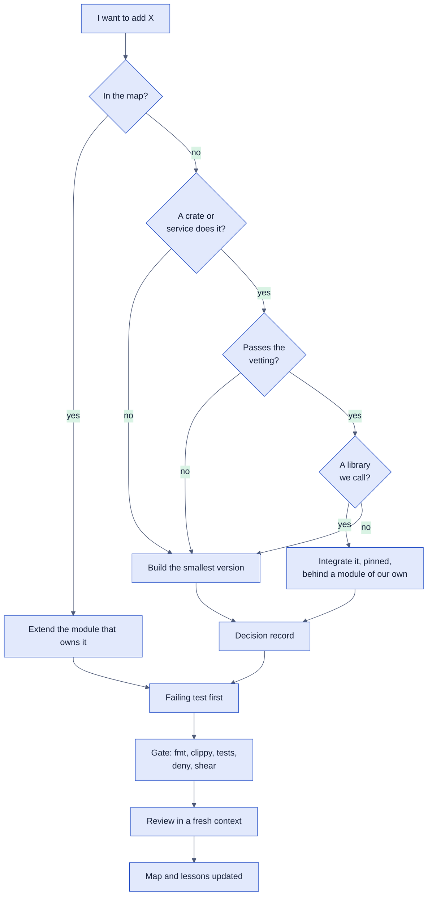

# Before you build

Phyllon integrates a strong, fitting solution where one exists and builds only
what is left. The tree comes from the
[design](../../../docs/specs/2026-10-29-phyllon-design.md), section "How the
code gets made".



## Walk the tree

1. **In the map?** `docs/map.md` names the module that owns each concern (until
   it exists, read the modules in `src/`). If one owns X, extend it.
2. **A crate or service does it?** Search before you write:
   `cargo search <words>`, <https://crates.io>, <https://lib.rs>, and for
   services their own docs.
3. **Passes the vetting?** Run every check below on each candidate. One that
   fails drops the candidate.
4. **A library we call?** Prefer a library that our code calls over a framework
   that calls our code. A framework passes when it offers an escape hatch back
   to plain calls. Weigh the candidates on the dials of the `conscience` skill.
5. **Integrate it, pinned, behind a module of our own,** so the rest of `src/`
   depends on our interface, not on the crate's.
6. Either way, write a **decision record** when the call is one a later
   contributor might question (record 0001's test), then go on with a failing
   test (rule 2 of [AGENTS.md](../../../AGENTS.md)), the gate
   (`scripts/check.sh`), the `review` skill, and an update to the map and
   `docs/lessons.md`.

## Vet a crate

```sh
crate=<name>

# It exists. An invented name exits 101 with "could not find". Inside the
# repository, a crate already in the tree shows its locked version.
cargo info "$crate"

# The last release, and the version to take: the newest that is not yanked,
# not a pre-release, and at least 7 days old.
curl -s -H 'User-Agent: phyllon-dev-tooling' \
  "https://crates.io/api/v1/crates/$crate" |
  jq -r --arg cutoff "$(date -u -d '7 days ago' +%FT%TZ)" '
    "last release: \([.versions[].created_at] | max)",
    ([.versions[]
      | select((.yanked | not) and (.num | contains("-") | not)
               and .created_at < $cutoff)]
     | max_by(.num | sub("[+].*"; "") | split(".") | map(tonumber))
     | "take: \(.num) of \(.created_at), \(.license)")'
```

- **Exists:** `cargo info` finds it, and its `repository:` line leads to real
  code. Models invent package names.
- **Maintained:** the last release is less than 12 months old, and the
  repository shows recent work.
- **7 days old:** take the version the query prints, never a younger one. A
  poisoned release usually lives for hours, not days. Rule 7 makes no exception;
  if a security fix is younger, ask the maintainer.
- **License:** the license it declares is in `[licenses] allow` in `deny.toml`.
  Then add it on your branch the way `Cargo.toml` writes its dependencies (the
  full version, `default-features = false`, the features you use) and check the
  whole new tree, transitive crates included:

  ```sh
  cargo add "$crate@<version>" --no-default-features --features <list>
  cargo deny check licenses bans sources
  cargo deny check advisories
  cargo tree -p "$crate" -e normal
  ```

- **Advisories:** `cargo deny check advisories` passes, and
  `https://rustsec.org/packages/<crate>.html` shows nothing open.
- **Docs of the pinned version:** read `https://docs.rs/<crate>/<version>` or
  the source in `~/.cargo/registry/src/*/<crate>-<version>/`, not your memory
  (rule 8).

`deny.toml` is a gate file. A crate that needs a new license or an exception is
a question for the maintainer, never an edit to get green.

## Vet an npm package, action or image

npm packages here are dev dependencies only, pinned exactly in `package.json`:

```sh
pkg=<name>
npm view "$pkg" license repository.url   # E404 when it does not exist
npm view "$pkg" time --json |
  jq -r --arg cutoff "$(date -u -d '7 days ago' +%FT%TZ)" '
    del(.created, .modified) | to_entries
    | map(select((.key | contains("-") | not) and .value < $cutoff))
    | max_by(.key | split(".") | map(tonumber))
    | "take: \(.key) of \(.value)"'
npm install --save-dev --save-exact --ignore-scripts "$pkg@<version>"
npm audit
```

CI's `dependency-review` job checks new npm and crate versions against the same
license list and fails on any advisory. An action is pinned by commit SHA with
its version in a trailing comment (`# v7.0.1`), and an image by tag and digest
(`caddy:2.11.7@sha256:...`).

## Justify it in the pull request

Rule 7 asks for this list, one line each:

```text
name: <crate>@<version> (crates.io: https://crates.io/crates/<crate>)
purpose: <what it does for us, and the module that wraps it>
license: <SPDX>, allowed in deny.toml
maintainer: <owner and repository>
last release: <date>; taken: <version> of <date>, at least 7 days old
```

## Write the decision record

Add `docs/decisions/NNNN-<slug>.md` in the format of
[0001](../../../docs/decisions/0001-decision-records.md): a title, the date, the
status, then Context, Options (with a table on the five dials when the choice
has real trade-offs), Decision and Consequences. Take the next free number; some
numbers are already reserved, so check the current plan in `docs/plans/` as well
as `docs/decisions/`.
