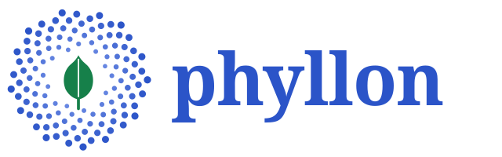

# 

Phyllon keeps a library of learning tasks with their answers, hints, solution
methods and connections, and serves it to any MCP client. It decides in code
everything that can be decided in code, and leaves the model only what needs
language: understanding a wish, explaining, encouraging.

## Status

A skeleton, nothing to use yet. Phase 1 builds the repository, the gate and the
way to run it. Learning tasks come in later phases; the
[roadmap](docs/roadmap.md) lists them.

## The principle

Decide in code, phrase in the model. A checker, a filter or a scheduler gives
the same answer every time, so Phyllon uses one wherever it can. The model
phrases checked building blocks, such as a verified hint or a stored method, and
does not invent them.

## Quickstart

See [docs/install.md](docs/install.md).

## Read on

- [Design](docs/specs/2026-10-29-phyllon-design.md): the vision and the
  high-level design.
- [Roadmap](docs/roadmap.md): seven phases from an empty repository to 1.0.
- [Contributing](CONTRIBUTING.md): the sign-off, pull requests and the gate.
- [Security](SECURITY.md): how to report a vulnerability.

## License

[AGPL-3.0-or-later](LICENSE).
