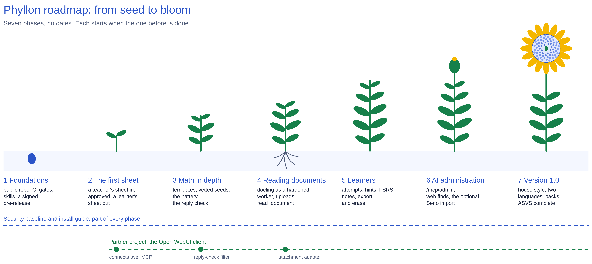

# Phyllon Roadmap

Seven phases from an empty repository to 1.0, taken from the [design](specs/2026-10-29-phyllon-design.md). There are no dates: each phase starts when the one before it is done, and "done" means every line under "Done when" can be shown, not claimed. Each phase gets its own detailed design and plan when it starts.

## 🧰 Before phase 1

- The project gets a hub in the maintainer's own notes and a board, so progress stays visible.
- The repository is created at `github.com/nemesis398/phyllon`, with the design, the research and the brand as its first commit.
- Done: the domain `phyllon.de` is registered.
- Serlo is asked about a bulk import, so the answer is in before phase 6 needs it.

## 🌰 Phase 1: Foundations, in public

Anyone can clone Phyllon, run the skeleton under Docker or Podman, and contribute under the same rules an agent follows.

**Done when:**

- The repository is public with README, LICENSE, CONTRIBUTING, SECURITY and CODE_OF_CONDUCT, and the install guide covers the skeleton.
- `compose up` starts Phyllon, PostgreSQL and the proxy under Docker and under rootless Podman with SELinux enforcing, and CI proves both. Quadlet units exist for Fedora.
- The gate (format, clippy, nextest, cargo-deny, cargo-shear) runs in CI, as a Stop hook and as a git pre-commit hook.
- `AGENTS.md`, the six skills, `docs/map.md`, the first decision records and `docs/lessons.md` exist, and CI checks the map and the skill links.
- A signed pre-release with an SBOM verifies with `gh attestation verify` and `cosign verify`, and the open question of whether release-plz's tag starts the dist workflow is answered.
- The web UI shell shows the brand in light and dark and passes an automated accessibility check.

## 🌱 Phase 2: The first sheet

The first real use works from end to end.

**Done when:**

- A parent's AI client reads a teacher's worksheet and submits its tasks through MCP, and they wait as pending.
- The parent approves them in the web UI, which shows the normalized text with invisible characters revealed.
- A learner's client, signed in through OAuth or a personal token, finds tasks, builds a 30-minute sheet and gets a PDF without a key for a guided profile.
- `check_answer` reports value and declared form for whole numbers, decimals and fractions.
- The math topic pack covers the topics of the first sheets.
- Decision records settle embedded Typst against the `typst` command and the embedding runtime, with measurements.
- The baseline's tests for tokens, registration, the policy check, web headers and the audit log pass.

## 🌿 Phase 3: Math in depth

Tasks with parameters, and the proof that weak models hold.

**Done when:**

- Templates generate variants, and a sheet uses only seeds that passed the template's tests.
- A saved recipe rerolls to new numbers, and the same seed always prints the same PDF.
- The checker tests equivalence at random points and the forms a task declares (lowest terms, factored, units).
- The eval battery runs nightly, and MiniMax M3.1 Flash and Haiku with high thinking pass it.
- `check_reply` finds leaked answers and solution steps, and the battery and the reply check share one rule set.

## 🪴 Phase 4: Reading documents

Phyllon reads what people photograph and upload.

**Done when:**

- docling-serve runs as a hardened worker, and the tests for its isolation and for the upload limits pass.
- Batch upload in the web UI and one-time upload links for clients both end in `read_document`, which returns tasks or a student's written answer as structured data.
- A student's photo of a written answer gets checked, and the photo is deleted once it is read.
- Source files disappear once their tasks are approved or rejected.

## 🎋 Phase 5: Learners

Phyllon remembers what each learner practiced, and helps with what comes next.

**Done when:**

- Attempts, hints step by step, time taken and the FSRS schedule drive "what to practice next".
- Typical mistakes are computed from attempts.
- Notes by people work, and notes by the AI wait for a parent or teacher to confirm them.
- Export and erase work, and an erased learner leaves no rows, embeddings, derived text or files behind.

## 🌼 Phase 6: AI administration and web finds

An AI client can curate the library without being able to take it over.

**Done when:**

- `/mcp/admin` runs as its own resource with its own tokens, off by default, and its tools only create pending requests.
- Approvals are final only in the web UI, and no admin tool can change rules, tokens, clients or login providers.
- Web finds from the client arrive pending, with their origin and source recorded.
- A corpus of injection strings and hidden characters, also inside PDFs, comes out stripped and labeled.
- The optional Serlo import works, with attribution kept, if Serlo agreed.

## 🌻 Phase 7: 1.0

Phyllon is ready for families and schools that run it themselves.

**Done when:**

- Worksheets print in the house style from a design session.
- German and English are complete, and a test language added through files alone shows that a new language needs no code.
- Export and import packs move openly licensed content between installations.
- The data-flow description, the record-of-processing template and the DPIA template ship, and the ASVS status file has no unexplained gap.
- Version 1.0.0 is released, signed and attested.

## 🔗 Alongside: the partner project

The Open WebUI setup becomes its own open-source client project. It follows Phyllon's phases instead of running on its own schedule:

| After phase | The partner project gets |
| --- | --- |
| 2 | A cleaned-up, generic setup that connects to Phyllon over MCP |
| 3 | The filter that runs the reply check on every reply |
| 4 | The adapter that forwards chat attachments to an upload link |
