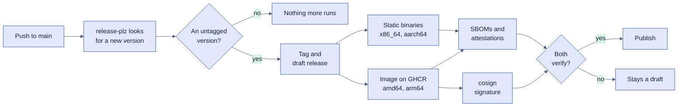

# Phase 1: Foundations, in Public

Date: 2026-10-29 · Approved by Mika on 2026-10-29 · Author: Mika Böhme with
Claude · Builds on: [the design](2026-10-29-phyllon-design.md),
[the roadmap](../roadmap.md),
[engineering quality](../research/engineering-quality.md),
[standards and security](../research/standards-security.md)

Phase 1 ends when anyone can clone Phyllon, run the skeleton under Docker or
Podman, and contribute under the same rules an agent follows. The roadmap lists
what has to be shown; this document decides how. It builds nothing for later
phases, but it reads phases 2 and 3 and names the doors it keeps open.

## 📋 Decisions at a glance

"Mika" marks a decision Mika made, "Call" a choice this document makes, which
Mika can overturn. "Call, to verify" is a choice that a spike early in the phase
confirms or replaces.

| Question                      | Answer                                                                                                                                                                                                                                                                                                           | By                           |
| ----------------------------- | ---------------------------------------------------------------------------------------------------------------------------------------------------------------------------------------------------------------------------------------------------------------------------------------------------------------- | ---------------------------- |
| Contribution terms            | The Developer Certificate of Origin: every commit carries `Signed-off-by:`, and CI checks every commit of a pull request                                                                                                                                                                                         | Mika                         |
| Sign-off on an agent's commit | An agent adds the sign-off of the person directing it, and only when that person has told it to commit; that person reviews the pull request before it merges. AI help is credited with a `Co-Authored-By:` trailer                                                                                              | Mika                         |
| Report channels               | Security: GitHub private vulnerability reporting first, `security@phyllon.de` as the fallback. Conduct: `conduct@phyllon.de`. Both aliases forward to the maintainer                                                                                                                                             | Mika                         |
| How changes land              | Every change goes through a pull request, the maintainer's and the agents' included. `main` is protected, and the gate must pass before a merge                                                                                                                                                                  | Mika                         |
| Merge style                   | Squash merges only, so the pull request title becomes the commit on `main`, and CI checks that the title is a conventional commit                                                                                                                                                                                | Call                         |
| `phyllon.de`                  | An HTTPS redirect to the repository; the repository's homepage field names the domain                                                                                                                                                                                                                            | Mika                         |
| Code of conduct               | Contributor Covenant 3.0                                                                                                                                                                                                                                                                                         | Call                         |
| Crate layout                  | One package, `phyllon`, with a library and a binary target. A workspace comes when a second crate earns its place                                                                                                                                                                                                | Call                         |
| Web stack                     | axum, with server-rendered HTML from askama templates; the shell ships no JavaScript                                                                                                                                                                                                                             | Call                         |
| Proxy in the compose stack    | Caddy, after a comparison with Traefik. A deployer who already runs a proxy leaves Caddy out                                                                                                                                                                                                                     | Mika                         |
| Fonts and assets              | In the repository and compiled into the binary; the UI makes no third-party request                                                                                                                                                                                                                              | Call                         |
| Accessibility check           | Playwright with axe-core, in light and in dark; the same run fails on any third-party request                                                                                                                                                                                                                    | Call                         |
| Markdown                      | prettier with prose wrapped at 80 columns, then markdownlint-cli2, both with a config in the repository and both checked in CI                                                                                                                                                                                   | Call                         |
| Podman with SELinux in CI     | A Fedora VM with SELinux enforcing, booted with KVM on a GitHub-hosted runner                                                                                                                                                                                                                                    | Call, to verify              |
| Release pipeline              | The release pull request is prepared on the maintainer's machine, so CI runs on it like on any other. When a new version reaches `main`, release-plz tags it and creates a draft release, and later jobs in the same workflow build, attest, sign and verify, then publish. dist stays only if it fits that flow | Call, to verify              |
| First release                 | `v0.1.0`. Every release before 1.0 is marked as a pre-release on GitHub                                                                                                                                                                                                                                          | Call                         |
| Versions and image tags       | Before 1.0, a breaking change or any database migration raises the minor number. Images get the exact version and its minor line, such as `0.1`; `latest` waits for 1.0                                                                                                                                          | Call                         |
| Ports                         | From the env file, 80 and 443 by default. The `localhost` quickstart uses high ports and needs no root                                                                                                                                                                                                           | Call                         |
| Commit address                | The maintainer's usual address, as in the first commit                                                                                                                                                                                                                                                           | Call                         |
| Targets                       | Linux on x86_64 and aarch64: static binaries and a multi-arch image on GHCR                                                                                                                                                                                                                                      | Call                         |
| Skills in phase 1             | Five. `task-authoring` arrives in phase 2, together with the pack format it describes                                                                                                                                                                                                                            | Call, changes a roadmap line |
| Security baseline in phase 1  | Items 12 to 17 and the header half of 18. The ASVS status file starts in phase 2, with the first login                                                                                                                                                                                                           | Call                         |
| Database in phase 1           | PostgreSQL 18 with pgvector in the stack, the three roles from the start, a readiness check, no tables                                                                                                                                                                                                           | Call                         |

## ✅ When phase 1 is done

The roadmap's six lines, each with the evidence that shows it:

| Done when                                                                                                                                                    | Shown by                                                                                                                               |
| ------------------------------------------------------------------------------------------------------------------------------------------------------------ | -------------------------------------------------------------------------------------------------------------------------------------- |
| The repository is public with README, LICENSE, CONTRIBUTING, SECURITY and CODE_OF_CONDUCT, and the install guide covers the skeleton                         | The files on `main`; GitHub's community profile complete; a fresh clone that follows `docs/install.md` reaches a running stack         |
| `compose up` starts Phyllon, PostgreSQL and the proxy under Docker and under rootless Podman with SELinux enforcing, CI proves both, and Quadlet units exist | Green runs of the Docker job and the Fedora job, each ending with the posture script's output                                          |
| The gate runs in CI, as a Stop hook and as a git pre-commit hook                                                                                             | A throwaway pull request that adds an `unwrap()` fails in CI, and the pre-commit hook and the Stop hook refuse the same change locally |
| `AGENTS.md`, the skills, `docs/map.md`, the first decision records and `docs/lessons.md` exist, and CI checks the map and the skill links                    | A throwaway pull request with an unmapped module fails, and so does one with a broken skill link                                       |
| A signed pre-release with an SBOM verifies with `gh attestation verify` and `cosign verify`, and the release-plz question is answered                        | `v0.1.0` on GitHub, the release workflow's verify job, and a decision record with the answer                                           |
| The web UI shell shows the brand in light and dark and passes an automated accessibility check                                                               | The browser run, with screenshots of both color schemes kept as artifacts                                                              |

## 🧱 The skeleton

One binary with two subcommands:

- `phyllon serve` reads a TOML config, connects to PostgreSQL as the runtime
  role, and serves HTTP on one port behind the proxy.
- `phyllon healthcheck` asks the local server for `/healthz` and exits 0 or 1.
  The distroless image has no shell and no curl, so the container healthcheck
  has to be the binary itself. It writes one request to a TCP socket and needs
  no HTTP client crate.

| Route       | Answers                                                      |
| ----------- | ------------------------------------------------------------ |
| `/`         | The shell's start page                                       |
| `/healthz`  | 200 while the process serves (liveness)                      |
| `/readyz`   | 200 when PostgreSQL answers `SELECT 1`, else 503 (readiness) |
| `/assets/…` | CSS, fonts and the logo, compiled into the binary            |

**Config.** `phyllon.toml`, found through `--config` or `PHYLLON_CONFIG`. No key
holds a secret: a secret is a `*_file` key that names a file, such as
`database_password_file`, which compose fills with a read-only bind mount and
Quadlet from a Podman secret (Mika, 2026-10-30). Unknown keys are an error, so a
typo cannot fall back to a default without anyone noticing.

**Code shape.** Modules `config`, `http` (router, headers, errors), `web`
(templates and assets), `db` (pool and readiness) and `cli`. Errors are one type
with generic messages to the client, and a catch-panic layer turns a panic into
a generic 500 while the server keeps serving.

**Headers.** Every response carries the headers from baseline item 18: a CSP of
`default-src 'self'; frame-ancestors 'none'; base-uri 'none'; form-action 'self'`,
`X-Content-Type-Options: nosniff`, `Referrer-Policy: no-referrer`, HSTS and a
restrictive `Permissions-Policy`. Phyllon sets them itself instead of leaving
them to the proxy, so they hold behind whatever proxy a deployer runs.
Integration tests check every header on every route.

## 🌐 The web UI shell

One base layout and one start page in the Frühling palette from
`brand/palette.css`:

- A header with the lockup; a main area that says what Phyllon is and that there
  is nothing to sign in to yet; a footer with the version, the license and a
  source link.
- **The source link is a license duty, not decoration.** AGPL-3.0 section 13
  obliges anyone who runs a modified Phyllon for others over a network to offer
  them its source. The link points at the exact tag or commit the binary was
  built from, and a config key lets the deployer of a modified version point it
  at their own source.
- Light and dark follow `prefers-color-scheme`. A manual switch needs a cookie
  or JavaScript, so it waits for a settings page.
- Atkinson Hyperlegible Next for all text, and the Fraunces wordmark inside the
  logo SVG. Both fonts are under the SIL Open Font License and ship in the
  repository with their license files.
- No JavaScript. The CSP forbids inline scripts anyway, so phase 2's first
  script will be a file under `/assets`.
- English strings, kept in one place, so phase 2 can move them into Fluent files
  without searching the templates.

The accessibility check runs axe-core through Playwright against the running
binary, once per color scheme, and fails on any violation. The same run records
every network request and fails on one that leaves the origin, which is the
browser half of baseline item 9. It is the only Node code in the repository:
`tests/browser/` with a pinned lockfile, which Dependabot updates like
everything else.

## 🐳 Running it

**`compose.yaml`** stays inside the subset that Docker Compose and
`podman compose` both accept:

| Service   | Image                                                  | Networks       | Publishes                       |
| --------- | ------------------------------------------------------ | -------------- | ------------------------------- |
| `proxy`   | Caddy, pinned by digest                                | `edge`         | The two ports from the env file |
| `phyllon` | `ghcr.io/nemesis398/phyllon`, pinned by digest         | `edge`, `db`   | Nothing                         |
| `db`      | `pgvector/pgvector` on PostgreSQL 18, pinned by digest | `db`, internal | Nothing                         |

- `db` is an `internal: true` network: no route out, and nothing outside reaches
  PostgreSQL. The `parser` network for docling-serve comes in phase 4.
- Every service runs with a read-only root where its image allows it, drops all
  capabilities, sets `no-new-privileges`, has memory and process limits and a
  healthcheck, and starts only after its dependencies report healthy. The
  posture script from baseline item 13 reads the `inspect` output and fails on
  any gap.
- Secrets are files. Phase 1 has three: the database passwords for the bootstrap
  superuser, the owner and the runtime role, and the install guide creates each
  with one command. They are mode 0444 inside a `secrets/` directory of mode
  0700, and each service mounts only the ones it needs, read-only with the `z`
  relabel, under `volumes:` rather than compose `secrets:`. Compose ignores
  `uid`, `gid` and `mode` for file secrets and rootless Podman shows the host
  owner as root, so a non-root service could not read a 0600 file, and SELinux
  denies a mount it has not relabeled (Mika, 2026-10-30).
- Caddy gets a certificate on its own for a public hostname and uses its
  internal CA for `localhost`, so the quickstart and a real installation share
  one file.
- **Ports** come from the env file, 80 and 443 by default. Rootless Podman
  cannot bind a port below 1024 unless the host allows it, so the `localhost`
  quickstart uses 8080 and 8443 and needs no root. A public installation under
  rootless Podman sets `net.ipv4.ip_unprivileged_port_start=80` once, and the
  install guide says so plainly. It is the one root step in any install path,
  and it comes from rootless containers, not from Phyllon: every web service
  under rootless Podman needs the same.
- `compose.podman.yaml` holds Podman-only options if testing shows any are
  needed. The aim is to need none.

**PostgreSQL** gets its hardening now, because changing roles under a running
installation is harder than starting with them. It accepts SCRAM only, and an
init script creates the `vector` extension and two roles: an owner for
migrations and a runtime role with data access only. Phase 1 has no tables, so
the owner waits for phase 2's first migration, but the tests from baseline item
12 already run: SCRAM is on, and the runtime role fails `CREATE TABLE`.

**Quadlet units** in `deploy/quadlet/`: one `.container` per service, the two
networks with `Internal=true` on `db`, the volumes, Podman secrets, and
`Notify=healthy`, so systemd starts the services in health order. The Phyllon
unit names the minor line, such as `0.1`, rather than a digest, so
`podman auto-update` follows patch releases and never crosses a database
migration, and the install guide pins Podman's signature policy to the build
workflow's identity, so an image that workflow did not sign is refused.

**The install guide**, `docs/install.md`, covers three paths (Docker, Podman and
Quadlet), how to check the image's signature and attestation before the first
start, and what phase 1 cannot do yet.

**Behind an existing proxy.** A host that already runs a proxy, such as Traefik
under Coolify, needs no second one. Caddy sits in a compose profile that the
default env file turns on, so such a deployer removes one line, and the Quadlet
path simply leaves the proxy unit out. The install guide shows the labels and
the shared network a Traefik setup needs. Phyllon then listens only on that
network, never on a published port, and the deployer's proxy terminates TLS; the
security headers still hold, because Phyllon sets them itself. Caddy stays the
default because the stack has one fixed upstream, and Traefik's strength,
finding containers by their labels, would need the container socket that
baseline item 13 forbids.

## 🚦 The gate and CI

**One script, three callers.** `scripts/check.sh` runs `cargo fmt --check`,
clippy with `-D warnings`, nextest, doctests, `cargo shear` and
`cargo deny check bans licenses sources`, and stays under three minutes on a
laptop. Three things call it:

- the git pre-commit hook in `.githooks/`, which a contributor turns on with the
  one `git config` line in CONTRIBUTING;
- Claude Code's Stop hook in `.claude/settings.json`, which runs it only when
  Rust, Cargo or workflow files changed since its last green run, so an agent
  that stops to ask a question does not wait three minutes; a failure blocks the
  stop and hands the output back to the agent;
- CI, as the first job of every pull request.

A `PostToolUse` hook formats each Rust file an agent edits, so the model sees
formatted code right away.

**The gate's own configuration.** `rust-toolchain.toml` pins the toolchain, so a
new Clippy release cannot turn CI red on an unrelated change. The lint baseline
from the engineering research goes into `[lints]` in `Cargo.toml`, and
`clippy.toml` allows `unwrap` and its relatives in tests only. `deny.toml`
allows crates.io as the only source and an allowlist of AGPL-compatible
licenses, and bans `openssl-sys`, so the binary stays static with rustls.
AGENTS.md says that a change to any of these files needs the maintainer's
explicit approval in the pull request.

**Markdown follows the same rule.** `.prettierrc.yaml` wraps prose at 80
columns, and `.markdownlint-cli2.yaml` turns off the line-length check for
tables, code blocks and Mermaid diagrams, which cannot wrap, and allows the same
heading under different parents. Every editor that runs prettier and
markdownlint on save then writes what CI expects, and CI runs both in check mode
on every pull request.

| Workflow        | Runs on                                                                                  | Jobs                                                                                                                                                                                                                                                                                                                                                                                                                                                                                |
| --------------- | ---------------------------------------------------------------------------------------- | ----------------------------------------------------------------------------------------------------------------------------------------------------------------------------------------------------------------------------------------------------------------------------------------------------------------------------------------------------------------------------------------------------------------------------------------------------------------------------------- |
| `ci.yml`        | Every pull request and every push to `main`                                              | The gate; integration tests against PostgreSQL 17 and 18 as service containers; `cargo doc` with warnings denied; `cargo deny check advisories`; the pull request title; the sign-offs; the map and skill-link checks; the browser checks; prettier and markdownlint on the Markdown files; the stack under Docker with the posture script; a dependency review of pull requests, which covers the npm tooling and the GitHub Actions that `cargo deny` does not (Mika, 2026-10-30) |
| `podman.yml`    | Pull requests that touch `compose*.yaml`, `deploy/` or the `Dockerfile`, and every night | A Fedora VM with SELinux enforcing: the stack under rootless `podman compose`, then under Quadlet, each followed by the posture script                                                                                                                                                                                                                                                                                                                                              |
| `workflows.yml` | Pull requests that touch `.github/`                                                      | zizmor and actionlint                                                                                                                                                                                                                                                                                                                                                                                                                                                               |
| `release.yml`   | Every push to `main`                                                                     | release-plz, and when a new version has reached `main`, the build, attest, sign, verify and publish jobs                                                                                                                                                                                                                                                                                                                                                                            |
| `scorecard.yml` | Weekly                                                                                   | OpenSSF Scorecard, shown as a badge                                                                                                                                                                                                                                                                                                                                                                                                                                                 |
| `nightly.yml`   | Every night                                                                              | `cargo deny check advisories`, so a new advisory surfaces without a code change; after the first release, a Grype scan of the published image that fails on high or critical findings and uploads SARIF to code scanning                                                                                                                                                                                                                                                            |

CodeQL runs through GitHub's default setup, a setting rather than a file. Every
workflow starts with `permissions: {}` and raises them per job, every action is
pinned by commit, and Dependabot updates crates, actions, image digests, the
toolchain and the browser test's packages after a 7-day cooldown. GitHub's
workflow lockfiles became generally available on 2026-10-28; the research says
to wait a month, so phase 1 pins by commit and looks at lockfiles again at its
end.

**The Fedora VM.** GitHub-hosted runners run Ubuntu, which has no SELinux, and a
container cannot enforce SELinux on itself. `ubuntu-latest` does expose
`/dev/kvm` once a udev rule opens it, so the job boots a Fedora Cloud image with
cloud-init and runs the stack inside. If the spike finds that too slow or too
flaky for pull requests, the fallback is a nightly run on the maintainer's own
hardware that pulls `main`, as the design already allows for GPU work, while
pull requests keep the Docker job.

## 🔏 Releases

- **Why a draft.** Phyllon's releases are immutable, and an immutable release
  takes no new assets once it is published. So release-plz creates the release
  as a draft (`git_release_draft = true`, with `git_only = true` because nothing
  goes to crates.io), and the jobs after it attach everything before the last
  one publishes.
- **Why one workflow.** A tag that release-plz pushes with the default
  `GITHUB_TOKEN` starts no other workflow. Running the build as later jobs of
  the same workflow avoids that without a stored token. The spike answers the
  design's open question by trying dist inside this flow: dist stays if it fits
  the draft-then-publish order with its generated workflow intact, and otherwise
  a short build job of our own does the work. A decision record keeps the
  answer.
- **SLSA Build Level 3** (added by Mika on 2026-10-30). Artifact attestations
  alone reach Build Level 2; Level 3 needs the build isolated from the workflow
  that starts it. So everything that builds or signs an artifact runs in one
  reusable workflow, `build.yml`, which `release.yml` calls. A called workflow
  runs inside the caller's run, so the reason for one workflow still holds. The
  attestations then name `build.yml` as their signer, and verification requires
  exactly that.
- **No stray network traffic.** Every job in `build.yml` and `release.yml`
  starts with StepSecurity's Harden-Runner in block mode, which lets the job
  reach only the hosts it needs (Mika, 2026-10-30, as is the crate list below).
- **What a release carries.** Static binaries for both architectures, each
  embedding its crate list through `cargo auditable` so a scanner can audit the
  shipped file, a CycloneDX SBOM of the crate graph, a multi-arch image on GHCR
  with BuildKit's SBOM and provenance, `actions/attest` provenance for every
  artifact, and a cosign keyless signature on the image.
- **Verify before publishing.** The last job before publishing runs
  `gh attestation verify --signer-workflow` with `build.yml` on each binary and
  on the image, and `cosign verify` with `build.yml`'s identity and issuer. If
  either fails, the draft stays a draft.
- **The release pull request.** A pull request that the workflow's own token
  opens starts no CI, so it could never pass the ruleset. Instead,
  `scripts/prepare-release.sh` runs `release-plz update` on the maintainer's
  machine, which raises the version from the conventional commits and writes the
  changelog, and the result goes up as a normal pull request with its sign-off.
  Merging it is the decision to release.
- **Versions and tags.** The first release is `v0.1.0`, and every release before
  1.0 is marked as a pre-release on GitHub. Before 1.0, a breaking change or any
  database migration must raise the minor number. Each release pushes the image
  under its exact version and its minor line, such as `0.1.0` and `0.1`, so a
  deployment on `0.1` takes patch releases on its own and moves to `0.2` only by
  a person's edit. `latest` waits for 1.0. Each release also attaches a
  `compose.yaml` with the image's digest filled in, which the install guide
  uses.

## 🤖 Agent setup and the map

**`AGENTS.md`** holds the rules: the research's fifteen, adapted to the
pull-request flow and the sign-off, and where things live. `CLAUDE.md` contains
only `@AGENTS.md`.

**Skills** live in `.agents/skills/`, with relative symlinks from
`.claude/skills/`:

| Skill              | What it is                                                                                                                                                                                                           |
| ------------------ | -------------------------------------------------------------------------------------------------------------------------------------------------------------------------------------------------------------------- |
| `conscience`       | Mika's own skill, published under a neutral name with its sources credited, after a pass through the house style                                                                                                     |
| `before-you-build` | The decision tree from the design, including the 7-day wait for new crate releases                                                                                                                                   |
| `review`           | A review in a fresh context from the diff and the spec, against a security checklist; each finding becomes a failing test first                                                                                      |
| `docs-style`       | The public part of the house style: no em dashes, American spelling, sentence-case headings, emoji as heading labels only                                                                                            |
| `commits`          | Conventional commits; the sign-off added only on the directing person's instruction, and the `Co-Authored-By:` credit; the message's claims checked against the diff; the pull request title as the commit on `main` |

**The superpowers plugin** is named in `.claude/settings.json` rather than
copied, for brainstorming, plans, test-driven development and debugging.

**`docs/map.md`** lists each module of `src/` with what it owns, its invariants
and the decision records behind it. A CI script compares the map with the module
files and fails on a module the map lacks and on an entry without a module.

**`docs/decisions/`** starts with a record of the format itself, which compares
options on the conscience's dials, and one record for each call here that a
later contributor might question: the package layout, axum with askama, Caddy,
the release pipeline after its spike, and the Podman CI path.

**`docs/lessons.md`** starts empty, with the shape each entry takes: the bug,
the rule or test that now catches it, and the pull request.

## 📄 Repository files and GitHub

- **README**: what Phyllon is in two sentences, the logo, the status (a
  skeleton, nothing to use yet), the principle, the quickstart, and links to the
  design, the roadmap, CONTRIBUTING and SECURITY. Badges for CI, Scorecard, the
  license, the latest release and OpenSSF Best Practices, and no more. The
  release badge arrives with the first release, and the Best Practices badge
  with the registration (Mika, 2026-10-30).
- **LICENSE**: the AGPL-3.0 text, unchanged.
- **CONTRIBUTING**: the sign-off, the pull-request flow, how to turn on the
  hooks, the gate, and AI-assisted contributions: welcome under the same rules,
  with the pull request saying what ran, what did not, and what the author is
  unsure of. An agent may add the sign-off of the person who directs it, only on
  that person's instruction, and the agent is credited with a `Co-Authored-By:`
  trailer.
- **SECURITY**: the two channels, which versions get fixes (the latest release
  only, until 1.0), a time to a first answer that one maintainer can keep, and
  how a fix gets disclosed.
- **CODE_OF_CONDUCT**: Contributor Covenant 3.0, with `conduct@phyllon.de`.
- **`.github/`**: issue forms for bugs and for proposals, a pull request
  template that asks for the sign-off and the honest report, and
  `dependabot.yml`.
- **GitHub settings** (PHY-12): the description, the homepage `phyllon.de`, a
  social preview image built from the lockup, Discussions, private vulnerability
  reporting, secret scanning with push protection, CodeQL's default setup,
  Dependabot alerts and security updates, immutable releases, approval before
  any outside contributor's workflow runs, and a ruleset on `main` that requires
  a pull request, the gate, the title and sign-off checks, signed commits (Mika,
  2026-10-30) and squash merges, and refuses force pushes and deletion. A script
  reads these settings through `gh api` and reports drift; the maintainer runs
  it after each change.

## 🙋 What only Mika does

- Create `security@phyllon.de` and `conduct@phyllon.de` as forwarding aliases
  before SECURITY and CODE_OF_CONDUCT are merged.
- Point `phyllon.de` at the repository with an HTTPS redirect.
- Tell an agent when to commit: that instruction is what the agent's sign-off in
  Mika's name stands for.
- Merge every pull request, and approve any change to the gate's configuration.
- Register the project at <https://www.bestpractices.dev> and fill in the
  passing-level form, which raises Scorecard's CII-Best-Practices check (Mika,
  2026-10-30).

## 🚫 Not in phase 1

- No sign-in, no OAuth and no MCP endpoint; `rmcp` arrives in phase 2.
- No tables and no migrations.
- No Fluent files, no manual theme switch, no JavaScript.
- No docling-serve and no `parser` network.
- No ASVS status file; it starts with the first login in phase 2.
- No website beyond the redirect, no crates.io release, no binaries for macOS or
  Windows.

## 🚪 Doors phase 1 keeps open

Phases 2 and 3 bring OAuth, MCP, the first tables, Typst and embeddings. Phase 1
builds none of it, and makes none of it harder:

- **Separate routers** for the web UI and for `/mcp` and `/mcp/admin`, so cookie
  and bearer authentication never share a route.
- **The database roles exist**, so phase 2's first migration runs as the owner
  and the server never holds more than data access.
- **The image base can change.** `ort` for embeddings may need glibc and a C++
  runtime, which would move the image from `distroless/static` to
  `distroless/cc`. The release jobs name the base image in one place.
- **Strings in one place**, ready for Fluent.
- **A public URL in the config**, so the second hostname for files that the
  security research asks for becomes a config key, not a redesign.

## 🔬 To find out early in the phase

Each is a short spike whose answer goes into a decision record before the work
that depends on it:

1. Whether a Fedora Cloud VM boots fast and reliably enough on `ubuntu-latest`
   with KVM to run the Podman checks on pull requests.
2. Whether dist fits the draft-then-publish release flow, or a build job of our
   own replaces it.
3. Whether Podman's signature policy can require the release workflow's keyless
   cosign signature for `podman auto-update`.
4. Whether a project-level Claude Code setting can hide a contributor's personal
   copy of a skill that the repository also ships, an open point from the
   design.
5. Whether Codex CLI runs hooks. If not, the git hook and CI are its only gate,
   and AGENTS.md says so.

## 🗺️ Order of work

Each step ends in one or more pull requests within the 400-line rule, and each
belongs to a step on the board:

1. **The rules first** (PHY-13, first half of PHY-14): README, LICENSE,
   CONTRIBUTING, SECURITY, CODE_OF_CONDUCT, `AGENTS.md` and `CLAUDE.md`, because
   agents build everything after.
2. **The gate** (PHY-15): the package with an empty `main`, the toolchain pin,
   the lints, `deny.toml`, `scripts/check.sh`, the hooks and `ci.yml`.
3. **GitHub settings** (PHY-12), once the checks the ruleset requires exist.
4. **The skeleton** (PHY-16): `serve`, `healthcheck`, config, readiness,
   headers, errors.
5. **Running it** (PHY-16): the Dockerfile, compose, Quadlet, the posture
   script, the Podman spike and `podman.yml`, the install guide.
6. **The shell** (PHY-18): layout, assets, the browser checks.
7. **Skills and the map** (rest of PHY-14): the five skills, `docs/map.md`, the
   decision records, `docs/lessons.md` and their two CI checks.
8. **Releases** (PHY-17): the release spike, `release.yml`,
   `scripts/prepare-release.sh`, `v0.1.0`.
9. **Acceptance**: each line of "When phase 1 is done" shown with its evidence,
   and M1 closes.
