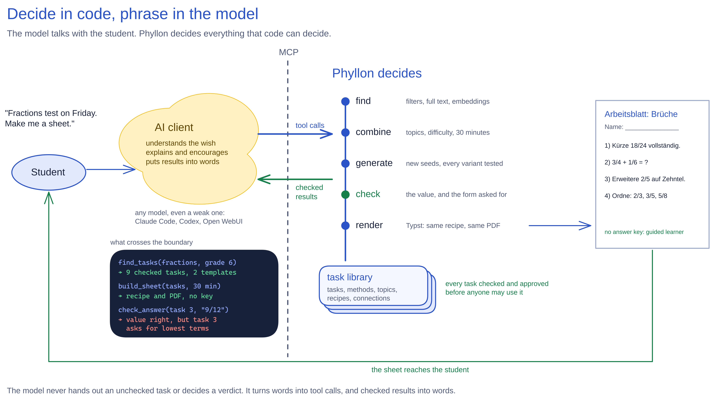
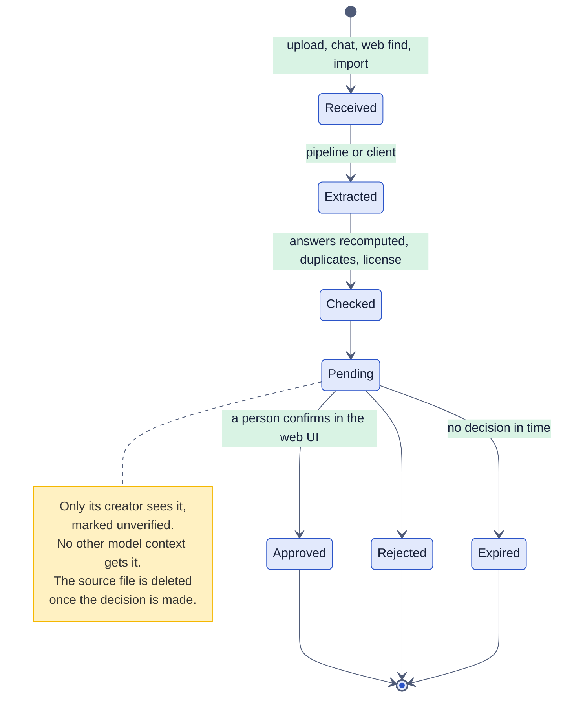
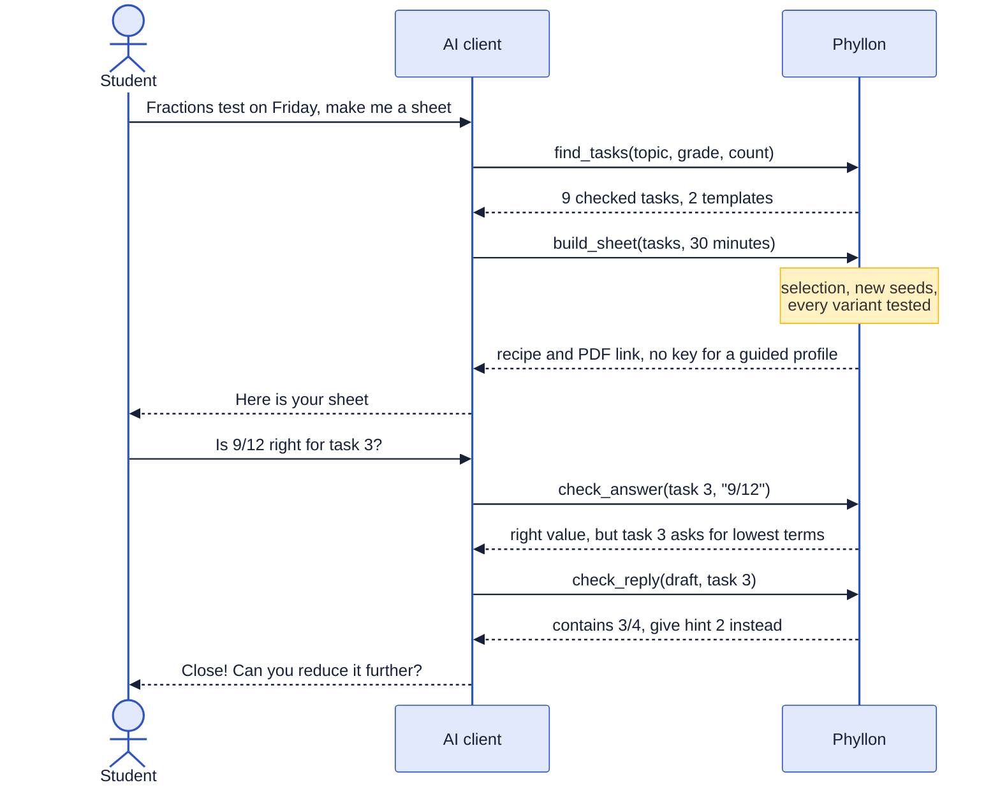
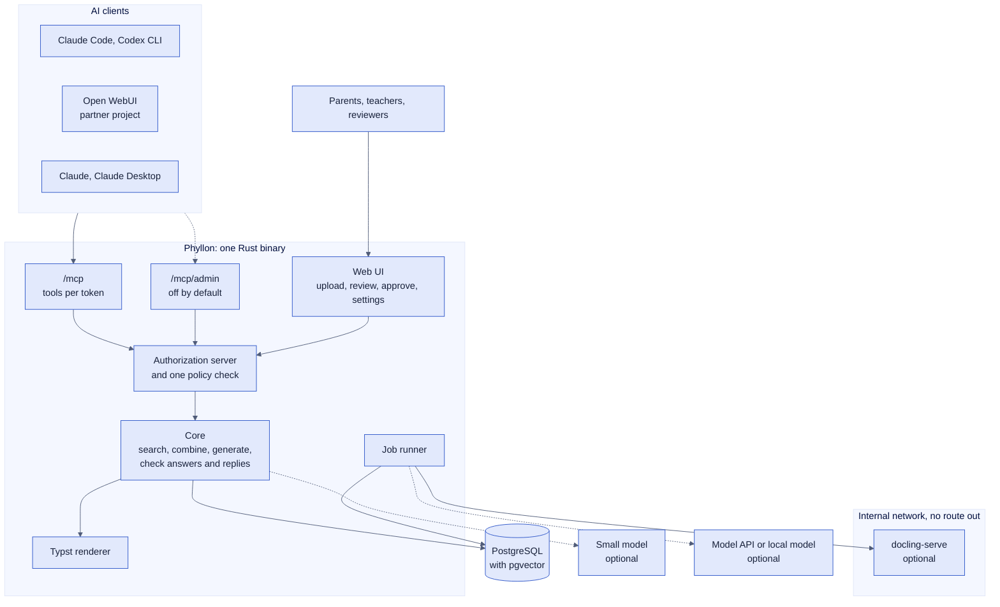
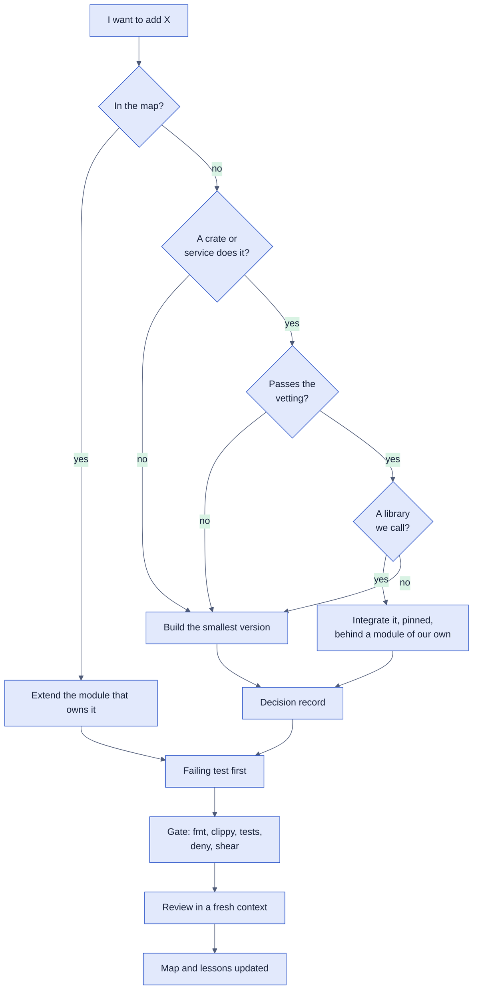

# Phyllon: Vision and High-Level Design

Date: 2026-10-29 · Version 2, approved by Mika on 2026-10-29 · Author: Mika
Böhme with Claude · Inputs: [prior art](../research/prior-art.md),
[technical check](../research/tech-check.md),
[standards and security](../research/standards-security.md),
[engineering quality](../research/engineering-quality.md),
[brand](../../brand/README.md)

This document says what Phyllon is, why it exists, and the decisions that shape
everything built later. It stays high level on purpose: each phase gets its own
detailed design when it starts, and the research documents hold the evidence and
the sources.

## 📋 Decisions at a glance

"Mika" marks a decision Mika made. "Call" marks a choice this design makes,
which Mika can overturn.

| Question                   | Answer                                                                                                                                                                                                                                             | By                     |
| -------------------------- | -------------------------------------------------------------------------------------------------------------------------------------------------------------------------------------------------------------------------------------------------- | ---------------------- |
| What Phyllon is            | A self-hosted task library, worksheet engine and checker that AI clients use over MCP. The server is the backbone; the client does the heavy lifting                                                                                               | Mika                   |
| What it checks             | It **verifies** content before approval, **checks** answers while someone learns, and **solves** where a profile allows it. Where code cannot decide, it hands the client's model the method and the criteria to judge by                          | Mika                   |
| Who it is for              | Students first, who build their own worksheets, mostly through an AI client. Parents and teachers fill and curate the library. Primary school to university and free learning. Any model gets better-structured, checked building blocks to phrase | Mika                   |
| The principle              | As deterministic as possible, so that even a weak model produces good output                                                                                                                                                                       | Mika                   |
| Integrate before you build | Where a strong, fitting and fast solution exists, Phyllon integrates it. The lookup runs before anything new is built, and the options are compared on the conscience's dials                                                                      | Mika                   |
| Public                     | Open-source code under AGPL-3.0 at `github.com/nemesis398/phyllon`, public from the first commit, with install guides and GitHub releases from the start. Each installation's content stays private                                                | Mika                   |
| Public docs                | Generic. Personal context stays out of the repo                                                                                                                                                                                                    | Mika                   |
| Stack                      | A Rust core, PostgreSQL with pgvector, docling-serve as a ready-made service for layout and OCR                                                                                                                                                    | Mika                   |
| Running it                 | Docker and Podman alike: one compose file for both, plus Quadlet units for Fedora                                                                                                                                                                  | Mika, Quadlet a call   |
| Topics                     | Math first and in depth; other subjects follow over time and start as plain tasks                                                                                                                                                                  | Mika                   |
| Topic graphs               | Data, not code: topic packs as files, loaded into tables in PostgreSQL                                                                                                                                                                             | Mika, storage a call   |
| Roles                      | Rules bundled into profiles that can be created, edited and deleted; predefined profiles ship                                                                                                                                                      | Mika                   |
| New content                | Pending until someone with the right approves it; source files are kept only until then                                                                                                                                                            | Mika                   |
| Administration by AI       | An admin MCP, opt-in and with security settings                                                                                                                                                                                                    | Mika                   |
| What the admin MCP may do  | Content work: create, edit, tag, merge, propose approvals. Security settings (profile rules, tokens, clients, identity providers) stay in the web UI. Approvals become final only in the web UI                                                    | Call                   |
| Who is asking              | OAuth per person and tokens from the start; later OIDC and SSO, so linked identities are in the data model now                                                                                                                                     | Mika                   |
| Shared tokens              | Personal tokens by default; a token shared by a profile is read-only: it finds, builds and checks, but saves no attempts and submits nothing                                                                                                       | Mika                   |
| Upload formats             | The server reads PDF and tested image types. Office files arrive as PDF exports or through the client; web pages only through the client, and Phyllon never fetches a URL a user gives it                                                          | Mika                   |
| Reading documents          | Phyllon reads them (OCR, layout, formulas), also for models that cannot see images or PDFs                                                                                                                                                         | Mika                   |
| Finding tasks              | Filters, then embeddings, then an optional reranker and an optional small model that parses a free-text request. Each stays only if the battery shows it helps                                                                                     | Mika, pipeline a call  |
| Answer forms               | Each task declares the forms it accepts, and the checker reports value and form against that                                                                                                                                                       | Call                   |
| Checking replies           | Before a reply reaches a student, the client can have Phyllon check it for leaked answers and solution steps                                                                                                                                       | Call, accepted         |
| Saved sheets               | Recipes, not PDFs: tasks, order, layout and a seed, rendered on demand                                                                                                                                                                             | Call, accepted         |
| PDF house style            | Layout, fonts and sizes come from a design session with Mika                                                                                                                                                                                       | Mika                   |
| Learner data               | Attempts, hints used, time, the repetition schedule; school context, computed typical mistakes, notes by people and notes by the AI                                                                                                                | Mika                   |
| Notes by the AI            | Pending until a parent or teacher confirms them, like any other content                                                                                                                                                                            | Call                   |
| Retention                  | Until deleted, with export                                                                                                                                                                                                                         | Mika                   |
| Partner project            | Mika's Open WebUI setup becomes its own open-source client project, and Phyllon links to it                                                                                                                                                        | Mika                   |
| Serlo                      | An optional source, off by default, with attribution kept                                                                                                                                                                                          | Mika                   |
| Agent setup                | The skills a contributor's agent needs live in the repo. Rules go into hooks and CI, judgment into skills                                                                                                                                          | Mika, the split a call |
| Security standard          | OWASP ASVS 5.0 level 2, plus three level 3 requirements                                                                                                                                                                                            | Call                   |
| CI                         | GitHub-hosted runners for everything a pull request runs; the paid battery on a schedule; GPU work pulled by the maintainer's own hardware                                                                                                         | Call                   |
| Formats                    | TOML for config, Markdown with TOML front matter for task files, LaTeX for math, JSON only where a protocol fixes it                                                                                                                               | Call                   |
| Languages                  | English code and docs; German and English UI from translation files, so a new language needs no code change                                                                                                                                        | Mika                   |
| The weak-model bar         | MiniMax M3.1 Flash and Haiku with high thinking must pass the battery before a release; small local models are measured for reference                                                                                                              | Mika                   |
| Deadline                   | None. The phases run in order                                                                                                                                                                                                                      | Mika                   |
| Identity                   | Name Phyllon, the seed-head mark, the Frühling palette ([brand](../../brand/README.md))                                                                                                                                                            | Mika                   |
| Domain                     | `phyllon.de`                                                                                                                                                                                                                                       | Mika                   |

## 🌱 Intent

Phyllon grew out of a family tutor built in Open WebUI: subject tutors for
learners from primary school to upper secondary, a worksheet AI, a math checker,
and a test battery that runs every rule against several models. Two lessons came
out of it.

1. **Models hold where a tool decides and slip where they judge.** MiniMax held
   every rule that a checker or LanguageTool decided. It invented grammar rules,
   profile entries and hints wherever it judged from its own knowledge.
2. **Every worksheet was generated from scratch.** Nothing a good sheet
   contained was kept, found again or reused.

Phyllon turns both lessons into a product that anyone can run. It keeps a
library of tasks with their answers, hints, solution methods and connections. It
decides in code everything that can be decided in code, and leaves the model
only what needs language: understanding a wish, explaining, encouraging. A
student says "I have a fractions test on Friday", and any MCP client, even a
weak one, can turn that into a fitting sheet from tasks that are already
checked.

Phyllon also supports the conversation while it happens. When the student
answers, Phyllon checks the answer. When the model drafts a reply, Phyllon can
check that the reply does not give the solution away. When the model needs to
explain, Phyllon hands it a verified method instead of letting it improvise one.
So the model phrases checked building blocks, and its replies get more
structured and more reliable.

The first real use: a practice sheet for a learner in a family installation,
built from teachers' worksheets and old class tests.

## ✅ Goals, non-goals, anti-goals

### Goals

- A student gets a fitting practice sheet through any MCP client in about a
  minute, and the AI writes no task to do it.
- A weak model gives good results. The eval battery measures this, not belief.
- The library grows from four doors (web upload, chat submission, web finds,
  imports), and every door ends in the same checks and the same approval.
- Math goes deep: tasks with parameters, every variant's answer computed and
  tested before use, answers checked for value and for form.
- Self-hosting takes one `compose up` and an env file, under Docker or rootless
  Podman with SELinux enforcing.
- Anyone can install it from the first public release: the install guide grows
  with every phase.
- The web UI meets WCAG 2.2 AA, because children and schools both need it, and
  it is cheap early and expensive late.

### Non-goals, for now

- **A chat interface.** The clients already have one.
- **A learning management system.** No courses, grades or class administration
  beyond the groups that rules need.
- **A hosted public service.** Each family or school runs its own installation.
- **Grading proofs and essays beyond a rubric.**
- **A polished student web app.** Students work through their AI client; the web
  UI stores, administers and verifies.
- **School certification.** Phyllon ships what a school needs to assess it (a
  data-flow description, a DPIA template), but the school or its IT provider
  carries the assessment.

### Anti-goals: it fails even if it works when

- A learner with a guided profile gets a stored solution through any tool,
  endpoint, search snippet or error message.
- A variant with a wrong answer reaches a sheet, or unapproved content reaches
  anyone but its creator.
- Text inside an uploaded document or a web page makes the admin MCP change
  something without a person's confirmation.
- Reprinting or rerolling a saved sheet needs a model.
- One installation's private content reaches another.
- Running it needs more than a container engine and an env file.

## 🧮 Decide in code, phrase in the model

Every part answers two questions: does AI improve the result here or only speed
it up, and does it need an LLM, or does code or a small model do it? The table
is the default; a phase design may move a row only with a measurement.

| Part                                    | Code decides                                                                                                          | Small model                                                           | LLM                                      | Default                     |
| --------------------------------------- | --------------------------------------------------------------------------------------------------------------------- | --------------------------------------------------------------------- | ---------------------------------------- | --------------------------- |
| Understand a wish ("Friday, fractions") |                                                                                                                       | Optional: parses free text into filters, its output held to a grammar | Turns it into a structured request       | Client's LLM                |
| Find fitting tasks                      | Filters on topic, grade, type, difficulty; full text                                                                  | Embedding similarity; an optional reranker                            |                                          | Code and embeddings         |
| Combine a sheet                         | Selection under constraints: topic coverage, difficulty curve, time, no repeats, "works well together" weights        |                                                                       |                                          | Code                        |
| New numbers for a task                  | Template, seeded generator, every seed tested before use                                                              |                                                                       |                                          | Code                        |
| A new template                          | Validates: generates variants and runs the template's tests                                                           |                                                                       | Proposes the template once               | LLM once, then code forever |
| Check an answer                         | Exact value, tolerance, equivalence at random points, the declared form, choice, unit tests for code                  |                                                                       | Rubric for open text only                | Code                        |
| Check a reply                           | The final value in any equivalent form, solution steps, hints beyond the unlocked level, anything the profile forbids | Optional: paraphrased leaks                                           |                                          | Code                        |
| Hints, solutions, methods               | Hands them out step by step                                                                                           |                                                                       | Drafts them once, a person reviews       | Stored                      |
| Read a document                         | Layout, OCR, numbering, figures                                                                                       | docling's layout and formula models                                   | Only where the segmentation is ambiguous | Code and small models       |
| Tag topic, grade, difficulty            | Rules                                                                                                                 | Nearest topic by embedding                                            | Below a confidence threshold             | Small model                 |
| Find duplicates                         | Hash of normalized text                                                                                               | Embedding similarity                                                  |                                          | Code                        |
| Render a PDF                            | Typst, in the house style                                                                                             |                                                                       |                                          | Code                        |
| What to practice next                   | FSRS scheduling, success rate per topic, typical mistakes                                                             |                                                                       |                                          | Algorithm                   |
| Missing content                         | Recomputes answers, records source and license, quarantines                                                           |                                                                       | Searches the web                         | Client's LLM, then code     |

**Search, step by step.** Each step is optional except the first, and each stays
only if the battery shows it improves the result:

1. Structured filters from the tool call (topic, grade, type) cost nothing.
2. An embedding model finds candidates by meaning. It is cheap, fast and gives
   the same result every time.
3. A reranker scores each request and candidate pair. It is still deterministic
   and writes no text.
4. A small LLM parses a free-text request into filters, held to a grammar. It
   pays off where a request arrives as free text, such as the web UI's search
   box or a weak client.

## 🔎 What Phyllon checks

Phyllon checks in three places, with the same rules:

- **Before approval it verifies**: answers recomputed, duplicates found, source
  and license recorded, a template's seeds tested.
- **While someone learns it checks**: an answer for value and for the forms the
  task declares. The task decides whether it wants lowest terms, a decimal, a
  mixed number, a unit, or any equivalent form.
- **Where a profile allows it, it solves**: for math it computes the result at
  runtime; for other tasks it holds the stored solution and method.

Where code cannot decide, Phyllon gives the client's model the method and the
criteria to judge by. For a guided profile it sends **criteria, never the
solution path**, because instructions sent to the client's model can leak to the
student.

**The reply check.** A tool such as `check_reply(draft, task)` lets the client
have a draft checked before the student sees it. Code does the work: Phyllon
knows the task, the answer and the student's profile, so it finds the final
value in any equivalent form (3/4, 0.75, 75 %), intermediate values of the
stored solution, a hint beyond the unlocked level, and anything else the profile
forbids. It ignores values that the task statement already shows, and allows the
answer once the student has solved the task. An optional small model catches
paraphrased leaks. The verdict names the rule from a fixed list and what to do
instead ("contains the final value 3/4, give hint 2 instead"), so a weak model
can fix its draft.

A client can skip the call, and the server cannot force it. The Open WebUI
partner project enforces it with a filter that runs on every reply; for plain
MCP clients the check is a recommendation, and the battery measures how often
each model skips it. The rules are the same ones the battery checks, so the two
cannot drift apart. General safety filtering (violence, unsafe content for
minors) is the client's job, with the tools that already exist for it.

## 🧱 Content model

- **Task**: statement, sub-parts, figures, answer, the answer forms it accepts,
  worked solution, hints in steps, and tags for subject, grade, topic, task
  type, difficulty, time and language. Versioned, so a recipe always prints what
  it printed.
- **Template**: a task with parameters, the constraints on them, the computed
  answer, and tests that every generated seed must pass before a sheet may use
  it (STACK's vetted-seed approach).
- **Method**: a way to solve a kind of task, written once and linked to every
  task it fits.
- **Topic**: a node in an open graph with typed links (prerequisite, part of,
  related). A curriculum, such as a state's syllabus, a university module or a
  vocational framework, is a view on the graph. Phyllon ships a curated math
  pack from grade 1 to the German Abitur, built on the KMK Bildungsstandards. A
  topic an AI proposes waits for approval like any content, so weak models
  cannot spawn near-duplicates.
- **Source**: title, publisher or URL, page, license and file hash. The file
  itself is kept only while its tasks wait for approval.
- **Origin and trust**: every item records how it arrived (upload, chat, web
  find, import) and whether a person has approved it.
- **Recipe**: a saved sheet with its usage count and ratings. It can be reused
  as it is, rerolled with new seeds, or tweaked.
- **Connection**: task to topic, method, source and similar tasks, plus "works
  well together", computed from recipes that were used and rated well rather
  than stored as a second copy.
- **Attempt**: a learner's answer, its verdict, time and hints used.
- **Status**: pending (visible only to its creator, marked unverified) or
  approved. Pending content expires after a configurable time.

**How the graph is stored.** PostgreSQL holds it as a `topics` table, a
`topic_edges` table (from, to, kind) and a mapping from curricula to topics and
grades. Recursive queries answer "all prerequisites of X", and a few thousand
topics take milliseconds. Three alternatives lost: Apache AGE is an extension
every self-hoster would have to install and upgrade; Neo4j is a second server
under GPL or a commercial license; `ltree` handles only trees, and prerequisites
cross branches. The topic pack in git is the exchange format, with stable IDs so
edits merge cleanly. The database holds the working copy.

## 🎒 Learner data

What Phyllon keeps, as Mika decided:

| Kind                   | Kept                                                                        | Notes                                                |
| ---------------------- | --------------------------------------------------------------------------- | ---------------------------------------------------- |
| Practice               | Attempts and verdicts, hints used, time taken, the FSRS repetition schedule | The basis for progress and for what to practice next |
| Context                | Grade, school type, state, textbooks                                        | So search fits without asking each time              |
| Typical mistakes       | Computed from the attempts, for example "often forgets to reduce"           | Code, never typed in by a model                      |
| Notes by people        | Free text by a parent or teacher about how the learner learns best          | Read by the client's model                           |
| Notes by the AI        | Observations the client's model records                                     | See the safeguards below                             |
| Photos of written work | Not kept                                                                    | Phyllon keeps what it read and deletes the picture   |

**Notes by the AI get safeguards**, because models invent profile entries and
because free text about a child is the data that data-protection guidance warns
about:

- They are pending until a parent or teacher confirms them, through the same
  approval as any content.
- They carry the label "written by AI", the date and the client that wrote them.
- The learner and their parents can read, edit and delete them.
- A rule on the profile allows them. The predefined profiles ship with it off,
  and an installation turns it on.
- Code never decides anything from them. They are context for the client's
  model, nothing more.

**Retention**: kept until deleted, with export. A learner or parent can export
or erase everything at any time, and erasing removes rows, embeddings, derived
text and files together. Schools can turn on a deletion job at the end of a
school year.

**Privacy by default**: a learner needs no real name, only a label. MCP output
carries no personal data beyond that label, because everything Phyllon returns
goes to the client's model provider. In Germany, Article 8 of the GDPR sets the
age at 16, so a parent or the school creates a child's account, and consent by
the child is never the legal basis.

## 👥 Rules, profiles and groups

A **rule** is one thing a user may do or see, often with a scope: see worked
solutions, see the key in a PDF, see hints, create tasks, trigger web search,
use unverified content in their own sheets, approve content, let the AI write
learner notes, see a learner's progress (own, group, all), manage users and
profiles, use the admin tools. A **profile** bundles rules; a user or a token
has one. A **group**, such as a family or a class, gives the scopes something to
point at. Rules are read from the database on every request, never copied into a
token, so a change applies at once.

Predefined profiles, editable like any other: Administrator, Reviewer, Parent or
teacher, Student (guided: hints only, never a solution), Self-learner (solutions
after an attempt), Agent (an AI client with admin tools).

**Three ways to say who is asking**, all available from the start, and the admin
chooses per client:

- **OAuth per person**: each person signs in to Phyllon from their client.
  Claude, Claude Code and Open WebUI all support it.
- **A personal token**: one token per person, for clients that hold a fixed
  token.
- **A shared token**: one token per profile, so Phyllon does not know the
  person. It is read-only: it finds tasks, builds sheets and checks answers, but
  saves no attempts and submits nothing, and its ID is logged on every use.
  Anything that writes or needs a person uses a personal token or OAuth.

"Guide, never solve" is a rule of the guided profile, enforced by the server:
such a token has no tool that returns a solution, and the reply check catches
what the client's model works out on its own. A family that needs a guarantee
also locks down the client, and the partner project shows how.

## 🔌 How clients connect

- **Two MCP endpoints, tools per token.** `/mcp` serves learning and curating;
  `/mcp/admin` serves the admin tools, switched off by default. Each is its own
  OAuth resource, and a token is bound to one of them, so a leaked ordinary
  token cannot reach admin tools. Within an endpoint, `tools/list` answers per
  token: a student sees a handful of tools.
- **Phyllon is its own authorization server.** It follows the OAuth 2.1 draft's
  profile (authorization code with PKCE only, exact redirect URIs, rotating
  refresh tokens), which RFC 9700 already requires in substance. Clients
  register in three ways, because real clients differ: a client ID metadata
  document (Claude, Claude Code), dynamic registration with constraints (Open
  WebUI and others), or a client the admin creates.
- **OIDC and SSO later, without a migration.** Identities are
  `(issuer, subject)` pairs linked to an internal user ID from day one. No
  identity hangs on an email address, which a school broker such as VIDIS would
  not even provide. An upstream login provider only signs the person in; Phyllon
  still issues the tokens its MCP endpoints accept.
- **Phyllon reads files; the routes bring the bytes.** MCP tool arguments are
  JSON only, and base64 inside a call would make the model write out every
  character. Three routes end in the same `read_document(handle)` tool:
  1. **An upload link**: a tool returns a one-time link, and the student uploads
     the photo or PDF through it. Works with every client, at the cost of one
     tap.
  2. **A client adapter**: in the Open WebUI partner project, a small function
     forwards chat attachments automatically. Claude Code or Codex upload a
     local file to the link with one command.
  3. **Native MCP file input**, once the spec's experimental extension lands.

  Phyllon returns text, tasks or the student's written answer as structured
  data, so a model that cannot see images still works with it.

- **Rules for the client's model live in the server's `instructions`**, short
  enough for every client (Codex advises about 512 characters, Claude Code cuts
  at 4,096). The tools carry the rest.
- **Subscription plans work from the client side only.** Anthropic and OpenAI
  both forbid a third-party product from offering their plan logins. A
  plan-backed Claude Code or Codex connects like any client; the server's own
  model calls use API keys or local models.
- **The partner project is the ready client.** The Open WebUI setup becomes its
  own open-source project with model files, the reply-check filter and the
  attachment adapter, so "add the MCP, activate it" is all it takes. It needs a
  cleanup into a generic setup first.

## 🏗️ Architecture

- **One Rust binary** serves the web UI and both MCP endpoints, runs the job
  queue (in PostgreSQL), renders PDFs with Typst and computes embeddings with a
  small multilingual model (`multilingual-e5-small`, 384 dimensions, as the
  starting point). A general REST API comes only when someone needs one; until
  then HTTP routes cover uploads, OAuth and health checks.
- **One core of plain functions, thin shells on top.** The web UI and the MCP
  endpoints call the same functions through the same policy check, so a rule
  cannot hold on one door and fail on another.
- **PostgreSQL with pgvector** holds everything. Search combines full text with
  vectors, because the German stemmer does not split compounds like
  "Bruchrechnung". The visibility predicate is part of every query, vector
  search included, so nothing is filtered after ranking.
- **docling-serve** is optional and treated as a hostile worker (see Security).
  Without it, documents go through the client path only. Its image ships English
  OCR data; German needs extra data or EasyOCR.
- **The small model** is optional: an embedding-adjacent reranker or a request
  parser, behind one function that narrows a request to candidates.
- **The server's own model** is optional too: one OpenAI-compatible client
  covers MiniMax, Ollama, llama.cpp, vLLM and LiteLLM. It runs only unattended
  batches and enrichment, always with schema-constrained output. A native
  Anthropic client comes only with a measured need, such as prompt caching.
- **Checkers are Rust**: exact rationals, a parser of our own, equivalence by
  evaluating at random points, form checks. They are a closed set, so they are
  one `enum` with a `match`, not a plugin system. University-level symbolic math
  gets a separate service (SymPy or Maxima) later.
- **Pinned on purpose**: `rmcp` (three major versions in eight months), Typst
  and the embedding runtime each sit behind a module of our own. Two choices
  wait for numbers in phase 2: embedded Typst against the pinned `typst`
  command, and `ort` against `candle` against the ready-made
  `text-embeddings-inference` container.

**Formats.** JSON stays only where something else fixes it.

| Where                       | Format                                                                   | Why                                                   |
| --------------------------- | ------------------------------------------------------------------------ | ----------------------------------------------------- |
| MCP messages, HTTP          | JSON                                                                     | The MCP spec and browsers fix it                      |
| Config                      | TOML, secrets from files                                                 | Comments, the Rust standard, none of YAML's traps     |
| Task and topic packs in git | Markdown with TOML front matter, one task per file; topic graphs in TOML | Diffable, reviewable in pull requests, merges cleanly |
| Math inside tasks           | LaTeX, converted to Typst at render time (`mitex`)                       | What docling, LLMs, Serlo and STACK all speak         |
| Database                    | Typed columns; JSONB only for checker parameters, tagged by checker kind | Constraints, queries, migrations                      |
| Job payloads                | Typed rows                                                               | No format beats any format                            |
| Export packs                | The same Markdown and TOML files, zipped                                 | One format, not two                                   |

**Built for today, planned forward.** Each phase design reads the next two
phases and lists the doors it must not close: linked identities, a language per
task, versioned tasks, a schema that does not assume math. It builds no code for
them. Plan forward in data and decisions; build for today in code.

## 🔐 Security

The [standards and security research](../research/standards-security.md) holds
the facts, the sources and a twenty-item baseline where each item has a test.
The decisions:

- **OWASP ASVS 5.0, level 2**, plus 5.2.4, 5.2.6 and 8.3.3 from level 3.
  `docs/security/asvs.md` lists every requirement as met, not applicable or a
  gap with an issue, and CI fails when one is missing.
- **Approval is a security boundary, not a quality step.** Admin tools only
  create pending requests. A person confirms in the web UI with a fresh login,
  and the screen shows the exact stored text after normalization, with invisible
  characters revealed, never a model's summary. An MCP confirmation dialog does
  not count, because a client hook can answer it. Whether the approver must be
  someone other than the submitter is an installation setting: a family with one
  admin approves its own submissions, and a school can require a second person.
- **Design for the injection that succeeds.** Uploads, chat submissions and web
  finds are untrusted channels whose text later reaches other people's model
  contexts. Phyllon strips invisible characters at ingest, render and MCP
  output, wraps content in labeled data fields, and offers no tool that runs SQL
  or fetches an arbitrary URL. The client that does web finds never holds an
  admin token.
- **Tokens.** Access tokens are opaque, stored hashed, short-lived and bound to
  one endpoint. Personal tokens carry a `phy_` prefix, are shown once, expire
  after at most 90 days by default, and cannot reach admin tools or approve.
- **One outbound HTTP client** for everything Phyllon fetches (client metadata,
  later OIDC discovery). It allows HTTPS only, checks resolved addresses against
  private ranges, follows no redirects, and caps time and size.
- **Uploads.** Phyllon decides the file type from its bytes against an allowlist
  of PDF and tested image types, and enforces size, page, pixel and quota limits
  before any parser starts. It strips EXIF data, because a phone photo can carry
  a child's home address. Originals are never served: they are deleted after
  approval, and the UI shows derived text and re-rendered images. That also
  keeps untrusted files off the web UI's origin.
- **docling-serve as a hostile worker.** It has had 28 security advisories in
  five months, and its defaults (a 7-day timeout, no limits, no API key, CORS
  `*`) are unsafe for untrusted input. It runs on an internal network with no
  route out and no published port, non-root, with a read-only root, all
  capabilities dropped, an API key, and a timeout of minutes.
- **PostgreSQL 17 and 18**, SCRAM only, reachable only on the internal network.
  Three roles: a bootstrap superuser that creates the `vector` extension, an
  owner for migrations, and a runtime role with data access only. Row-level
  security backs up a few owner-only tables; the real control is the query
  layer.
- **Containers.** A static, distroless, non-root image with a read-only root;
  secrets as files; images pinned by digest. Internal links on one host stay
  plain on `internal` networks, recorded as a deviation from ASVS 12.3.
- **Releases** carry an SBOM, provenance attestations and a keyless signature,
  and GitHub releases are immutable.

## ⚖️ Data protection and law

Not legal advice; the research marks what is inference.

- **The deployer is the controller**: a family, a school or its IT provider. A
  family installation is probably covered by the household exemption; a school
  installation is not, needs a processing agreement with its hoster, and
  probably a DPIA. Phyllon ships a data-flow description, a record-of-processing
  template and a DPIA template, and the docs say plainly that it is not
  certified for schools.
- **The Cyber Resilience Act** probably does not cover a private maintainer who
  does not monetize the project. Phyllon prepares anyway, because the same steps
  are good security: a `SECURITY.md` with a disclosure path, an SBOM per
  release, a stated update policy, secure defaults (no default passwords, the
  admin MCP off) and signed releases. Taking money in any form needs a lawyer
  first.

## 🛠️ How the code gets made

AI writes code with the same flaws it can find in others' code: rereading its
own output caught little in the studies, prompt rules measured no effect, and
feedback from compilers, tests and analyzers helped. The
[engineering research](../research/engineering-quality.md) has the numbers. So
**rules go into hooks and CI, and judgment goes into skills**: an agent can
ignore a skill, but not a failing check.

**The repo's map, modeled on a knowledge vault:**

- `AGENTS.md` holds the rules; `CLAUDE.md` only imports it.
- `docs/map.md` lists every module, what it owns, its invariants and the
  decision records behind it. CI fails when a module is missing.
- `docs/decisions/NNNN-*.md` holds one record per decision, comparing the
  options on the conscience's dials.
- `docs/lessons.md` turns every bug a review finds into a rule or a test.

**The decision tree for "I want to add X".** The vetting asks for an
AGPL-compatible license, active maintenance, no open advisory, and proof that
the crate exists. "A library we call" also accepts a framework that offers an
escape hatch back to plain calls.

**Skills in the repo.** They live in `.agents/skills/`, which Codex, Cursor and
Gemini CLI read; Claude Code reaches them through relative symlinks in
`.claude/skills/`. A CI check confirms every link resolves. The first set:

| Skill              | What it does                                                                                                                                                                                      |
| ------------------ | ------------------------------------------------------------------------------------------------------------------------------------------------------------------------------------------------- |
| `conscience`       | The design and review lens: compress on the second occurrence, no folklore lines, name the dials a decision turns                                                                                 |
| `before-you-build` | Runs the decision tree above: the map, existing crates, license, maintenance, advisories, proof that a crate exists, a 7-day wait for new releases, the docs of the pinned version                |
| `review`           | A review in a fresh session, ideally by another model family, from the diff and the spec without the author's reasoning, against a security checklist; every finding becomes a failing test first |
| `task-authoring`   | How to write a task or template in the pack format, declare its answer forms and checker, and add seed tests                                                                                      |
| `docs-style`       | The house style for docs: no em dashes, American spelling, sentence-case headings                                                                                                                 |
| `commits`          | Conventional commits, with the message's claims checked against the diff                                                                                                                          |

`conscience` is Mika's own skill, written with an AI, so it ships under the
repo's license. Its public copy drops the original's name, which would read as
an endorsement by a real person, credits the ideas in its sources file, and gets
a pass for the house style. The process skills (brainstorming, plans,
test-driven development, debugging) come from the superpowers plugin, which the
repo's Claude Code settings name instead of copying it. A new skill comes in
when the same review comment shows up a second time.

**Rules for agents** (fifteen in the research, the core here): run the full gate
and show its output before saying done; write the failing test first; never
weaken a gate to get green; no `unsafe`, `unwrap`, `expect` or `panic!` outside
tests; SQL only through checked queries with bound parameters; treat every input
as hostile, model output included; justify every new dependency; read the docs
of the pinned version; keep a pull request near 400 lines; measure before
optimizing; keep money and secrets out of tests; report what ran and what did
not, and explain non-obvious choices so the maintainer keeps understanding the
code. A Stop hook and a git pre-commit hook run the gate, so the rule does not
depend on the agent remembering it.

**The toolchain**: rustfmt; clippy with pedantic warnings and named restriction
lints; cargo-deny for advisories, licenses and sources; cargo-shear; nextest;
proptest for invariants and parsers; cargo-mutants on the changed lines of a
pull request; sqlx offline checks; CodeQL. For finding slow code: the database
first (`EXPLAIN (ANALYZE, BUFFERS)`), then samply with the Firefox Profiler,
tokio-console and dhat; instruction-count benchmarks with gungraun in CI.

## 🚦 CI and releases

| Job                                                                                                  | Where                                                                                   | When                                                 |
| ---------------------------------------------------------------------------------------------------- | --------------------------------------------------------------------------------------- | ---------------------------------------------------- |
| Format, lints, tests, cargo-deny, cargo-shear, sqlx check, docs, workflow lints (zizmor, actionlint) | GitHub-hosted, free for public repos                                                    | Every pull request and push to `main`                |
| CodeQL                                                                                               | GitHub default setup                                                                    | Pull requests, pushes, weekly                        |
| Mutation tests on the changed lines                                                                  | GitHub-hosted                                                                           | On a label or nightly                                |
| Compose stack under Docker and rootless Podman with SELinux                                          | GitHub-hosted                                                                           | Pull requests touching deployment, nightly           |
| Release build, container image, SBOM, attestation                                                    | GitHub-hosted                                                                           | Release                                              |
| The paid battery (MiniMax, Haiku)                                                                    | GitHub-hosted, keys in protected environments, compiling in a separate job without keys | Schedule and manual start only, never a pull request |
| GPU and local-model runs                                                                             | The maintainer's own hardware pulls the public repo                                     | Its own schedule                                     |

Self-hosted runners never take jobs from a public repo's pull requests: anyone
can open one, and a personal account cannot fence a runner off. Actions are
pinned by commit, workflows get read-only permissions by default, and Dependabot
updates crates, actions and image digests after a 7-day cooldown, because
poisoned crates in August 2026 ran malware from their build scripts during
`cargo build`.

**Releases**: release-plz turns conventional commits into versions and
changelogs, and dist builds the binaries; container images go to GHCR. Whether a
tag created by release-plz starts the dist workflow is untested and gets checked
in phase 1.

**Running it**: one `compose.yaml` within the subset both Docker Compose and
`podman compose` accept, Podman-only options in a second file, and Quadlet units
for Fedora, which give systemd restarts, health ordering, auto-update and
journald logs. Three networks: one from the proxy to Phyllon, and internal ones
to PostgreSQL and docling. Only the proxy publishes a port.

## 🌍 Languages and licensing

- UI text lives in Fluent files per language, loaded at start; plural rules come
  from ICU4X data, because Fluent's own plural data is CLDR 33 from 2018.
- Every task carries its language. Worksheet labels ("Name", "Datum") come from
  the same translation files.
- Code under AGPL-3.0. Shared content under CC BY-SA 4.0, with source and
  license on every task, so only openly licensed content leaves an installation
  in an export pack.
- **Serlo** is an optional source, off by default. Its 6,136 German tasks are CC
  BY-SA 4.0, which allows copying and adapting with three conditions: name the
  source ("Quelle: serlo.org" and "Lizenz: CC BY-SA 4.0", each with a link),
  mark changes, and keep adapted versions under the same license. Every imported
  task carries its attribution, and exports keep it. The license does not cover
  the API's terms, so the project asks Serlo before a full import.

## 📏 Measuring the principle

Phyllon ships an eval battery: scenarios in files, each run through the real MCP
endpoint with a temporary token against any model. It flags a solution shown to
a guided profile, a skipped reply check, a wrong tool call, an invented fact,
and a sheet that misses its constraints. **The bar: MiniMax M3.1 Flash and
Haiku, both with high thinking, must pass** before a release. Small local models
run the same battery and are reported for reference, without blocking. The
battery's "must not contain" rules and the reply check share one definition.

## 🗺️ Order of work

High level; the roadmap turns it into milestones. Security and the install guide
grow in every phase rather than waiting for the end.

1. **Foundations, in public**: README, LICENSE, CONTRIBUTING, SECURITY,
   CODE_OF_CONDUCT and the first install guide; `AGENTS.md`, the skills, hooks
   and CI gates; the map, decision records and lessons; the skeleton binary with
   a health check; compose and Quadlet files; a first pre-release that proves
   signing and attestation; the brand in the web UI.
2. **The first sheet**: tasks, the math topic pack and recipes; tasks submitted
   by a client through MCP; the review queue; Typst PDFs in a plain default
   style; profiles, OAuth with all three registration paths, personal tokens,
   linked identities and the audit log; find, build and check through MCP with
   exact values and declared forms; the Typst and embedding measurements. Enough
   for the first real use: a parent's Claude Code reads a teacher's worksheet
   and submits its tasks, the parent approves them, and a learner's client
   builds a sheet.
3. **Math in depth**: templates, vetted seeds, rerolls, equivalence and form
   checks; the eval battery; the reply check.
4. **Reading documents**: docling-serve as a hardened worker, batch upload,
   upload links and `read_document`, sources kept until approval.
5. **Learners**: attempts, hints step by step, FSRS, typical mistakes, notes by
   people and by the AI, export and erase.
6. **AI administration and web finds**: `/mcp/admin` with out-of-band approval,
   web finds through the client, the optional Serlo import.
7. **1.0**: the PDF house style from a design session, the second UI language
   complete, export and import packs, the data-protection templates, a complete
   ASVS status file.

## ❓ Open

To find out when the phase that needs it is designed:

- Asking Serlo about a bulk import, before any starter content depends on it.
- Whether Codex CLI registers through client metadata or dynamic registration;
  it does take a static token.
- Whether docling-serve runs with a read-only root and no network, and whether
  it reads HEIC photos.
- Whether a project-level Claude Code setting can hide a contributor's personal
  copy of a skill that the repo also ships.

## 🧭 Left to the builder

- The database schema, the MCP tool names and shapes, and the HTTP routes.
- The topic pack's file format within the formats table, and which small model,
  if any, earns its place by the battery.
- Crate choices within the decision tree, and the HTML templating for the web
  UI.
- The job queue's design: a `SKIP LOCKED` loop of our own against a job crate,
  decided on the dials.
- The embedding model, if a measurement beats `multilingual-e5-small`, and the
  docling-serve configuration within the security rules.
- The exact tolerances and point counts of the equivalence check, starting from
  WeBWorK's and Numbas's defaults (5 points, 1e-4).
- The full list of agent rules in `AGENTS.md`, starting from the research's
  fifteen.
